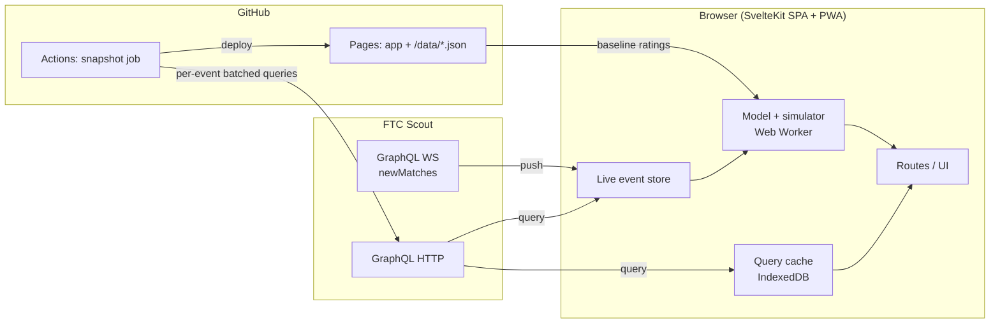

# FTCPanel — Architecture & Feature Outline

Status: v0.1 (2026-11-22). Phases 0–1 built, event matchups built. Season in scope: 2026–27 **BIOBUZZ** (FTC Scout `season: 2026`).

## 1. Priorities (ranked)

1. **Freshness** — event rankings and match results update as soon as FTC Scout has them.
2. **Phone and desktop both first-class** — one-handed use on a phone at a venue with bad Wi-Fi, *and* a dense multi-column desktop layout. Neither is a shrunk or stretched copy of the other.
3. **Matchups** — how any matchup would go: win probability, predicted score, where each alliance is stronger or weaker, with graphs.
4. **Analysis** — visualization, comparison, projection, prediction.
5. **Team Center** — a home screen built around *your* team.

Non-goals for v1: user accounts, a backend server, scouting data entry, re-implementing FTC Scout's raw data browser.

## 2. Verified constraints

Probed 2026-11-22 against the live APIs.

| Fact | Consequence |
|---|---|
| Hosting is GitHub Pages (`ftcpanel.github.io`): static files only | No server. Live data goes straight from the browser to FTC Scout; derived data is prebuilt by GitHub Actions. |
| `POST https://api.ftcscout.org/graphql` allows origin `https://ftcpanel.github.io` (preflight OK); `Cache-Control: no-store` to clients, **but responses are cached server-side per query text** (`X-GQL-Cache-Time`; a changed query text gets a fresh entry) | GraphQL is the primary data source. HTTP refetches can be up to ~2 min stale. |
| REST `/rest/v1/*` answers with `Cache-Control: max-age=120` behind Cloudflare | REST can be up to 2 min stale → **never used on live paths**. |
| `Subscription.newMatches(season, code): [Match!]` over `wss://api.ftcscout.org/graphql`, subprotocol `graphql-transport-ws`. Observed live at USNJCENM3 on 2026-11-22: pushes arrived **66–116 s before** the same match showed up in polled GraphQL responses (3 matches) | **Pushes are the only immediate signal.** Everything time-sensitive (results, rankings, predictions) is derived from pushed matches in the browser; refetches must never roll back pushed data. |
| A single query for all 2026 matches → Cloudflare **524 after ~100 s** | Bulk pulls must be per event, with limited concurrency. |
| Per-event query (33-match qualifier, scores + stats): ~0.2 s, 19 KB raw / 2.4 KB gzip | Live event refetch is cheap; pulling a whole season (~1.5k events) in batches is feasible in CI. |
| Scale — 2025: 45,392 matches, 8,868 active teams, 1,505 events with matches. 2026 so far: 8,369 / 6,664 / 386 | Season-wide model state fits in a few hundred KB when stored by column. |
| The schema is typed per season (`TeamEventStats2026`, `MatchScores2026` unions) | Season-specific code lives behind a **season adapter** (§6). |
| 2026 scores: `autoPoints + dcPoints = totalPointsNp`, `totalPointsNp + penaltyPointsByOpp = totalPoints` (66/66), `dcPoints = dcHive + dcFlower + dcGarden + dcPark` and `autoPoints = autoLeave + autoPark + autoHive` (388/388) | Components auto / teleop (`dcPoints − dcParkPoints`) / endgame (`dcParkPoints`); penalties modeled separately. |
| `Event.previewStats` returns each registered team's stats from an earlier event (null for teams that haven't played) | Prior for the matchup model before/early in an event. |
| FTC Scout docs: "Please do not abuse the API or we may have to add rate limiting" | Clients never crawl the whole season. One WebSocket per client; polling only when the tab is visible and the event is ongoing. |

## 3. System overview



### Data tiers

| Tier | Source | Freshness | Used for |
|---|---|---|---|
| **Live** | FTC Scout GraphQL subscription + query, from the browser | Same as FTC Scout (seconds after a match is posted) | Event matches, event rankings/OPR, Team Center live card, predictions for the rest of the event |
| **Warm** | FTC Scout GraphQL on demand, stale-while-revalidate, persisted to IndexedDB | On navigation; refetched when the tab is focused again | Team pages, event lists, season history, awards, `quickStats` |
| **Baseline** | GitHub Actions snapshot → static JSON on Pages | Every 15 min (scheduled; GitHub may delay runs) | Season-wide EPA ratings, leaderboards, percentiles, model parameters, accuracy stats |

Rule: **live always overrides baseline.** The baseline exists only to avoid having every client crawl the season.

## 4. Freshness design

### Event pages and Team Center

1. On mount: one GraphQL query for the event (`matches{teams scores}` + `teams{stats}` + `previewStats`) → render.
2. Subscribe to `newMatches(season, code)` on a single shared `graphql-ws` connection. Feeds are shared per event per tab (`acquireLiveEvent`), so the event page and its matchup page reuse one subscription; a released feed lingers 15 s.
3. On push:
   - merge the matches into the live store → the schedule, results, and score breakdowns update immediately, new results are highlighted;
   - the matchup model refits in the browser (milliseconds), so every upcoming match's win probability updates with it;
   - rankings update in the same tick: FTC Scout's official stats (from the last refetch) extended with the pushed results they don't count yet (`liveStandings`, `src/lib/model/rankings.ts`). End-to-end check: result and re-ranked table on screen within 0.5 s of the push.
4. Safety refetch every 60 s while live: OPR updates, score edits, schedule changes. A refetch keeps any pushed result newer than its (cached) copy.
5. Fallbacks (mobile browsers kill sockets in the background):
   - socket down → `graphql-ws` reconnects with exponential backoff (1 s → 30 s cap) while the event is refetched every 20 s; on reconnect, one catch-up refetch;
   - `visibilitychange` back to visible or `online` → immediate refetch and resubscribe;
   - no subscription or polling when the tab is hidden, offline, or the event is not `ongoing`.
6. No connection badge in the UI: data updates silently. A warning line appears only when a refresh fails.

REST is never used here (120 s CDN cache). Ranking rules (RS = mean of 3 win / 1 tie + bonus RPs; TB1 = mean np score; TB2 = mean tips) were matched against FTC Scout on 596 teams from 30 events: records 596/596, RS 588/596. The 8 mismatches carry RP not derivable from scores, which is why official stats stay the base and only not-yet-counted matches are added locally.

### Live rating delta

The snapshot carries ratings as of `asOf` plus the set of processed match keys. The client applies the **same EPA update function** (`src/lib/model`, shared with the pipeline) to every live match it sees that the snapshot has not processed. Ratings for teams at events being watched are therefore current. Global leaderboards stay at baseline freshness (≤15 min on event days).

### Floor

We cannot be faster than FTC Scout's own sync from the FIRST API. The target is **zero added latency** on top of FTC Scout for event data.

## 5. Tech stack

| Concern | Choice | Why |
|---|---|---|
| Framework | **SvelteKit 3** + `adapter-static` (SPA, `fallback: '404.html'`), Svelte 5 runes, TypeScript | **Decided.** Smallest runtime of the candidates (initial JS ≈71 KB gz today) → faster on mid-range phones; compiled reactivity suits a live-updating store; FTC Scout's frontend is also SvelteKit. Kit 3 convention: `#lib/…` imports with explicit `.ts` extensions. |
| Queries + cache | TanStack Query (Svelte adapter) + IndexedDB persister | Stale-while-revalidate, refetch on focus, offline last-known data |
| Subscriptions | `graphql-ws` client | Matches the server's `graphql-transport-ws` protocol |
| Typing | `@graphql-codegen` against a committed `schema.graphql` from introspection | Season unions stay type-checked |
| Charts | Apache ECharts, modular imports (`src/lib/charts/echarts.ts`), SVG renderer, dynamically imported by `Chart.svelte` | Touch tooltips, theming from CSS tokens (light/dark). One chart library only. The ECharts chunk is ~195 KB gz and loads only on chart pages. |
| Styling | Tailwind CSS; Geist (text) + Outfit light (headline numbers), self-hosted via Fontsource | Fast breakpoints; design tokens in `src/routes/layout.css` |
| Heavy compute | Web Worker (Monte Carlo, bracket sim) | Keeps the UI responsive on phones |
| Offline | SvelteKit service worker: precache the app shell, network-first for `/data/*`; GraphQL is never cached by the SW | Venue Wi-Fi |
| Pipeline | Node + TS scripts in `pipeline/`, importing `src/lib/model` and `src/lib/seasons` | One model implementation for CI and the client |
| Tests | Vitest (model, adapters, live merge); Playwright on iPhone/Pixel viewports | |

## 6. Data model

### Season adapter

All season-specific knowledge lives in one file per season (`src/lib/seasons/2026.ts`), registered in `src/lib/seasons/index.ts`:

```ts
interface SeasonInfo {
  season: number;                          // 2026
  name: string;                            // "BIOBUZZ"
  components: { key; label; short }[];     // auto / teleop / endgame
  rps: { key; label }[];                   // swarmRp, pollinator1Rp, pollinator2Rp
}
allianceScore(raw: Alliance2026Fragment): AllianceScore    // components, RP flags, breakdown rows
teamStats(raw: TeamStats2026): TeamEventStats              // rank, RS, W-L-T, OPR/avg per component, RP rates
```

GraphQL fragments per season live in `src/lib/api/queries.ts` (codegen needs static documents). 2026 component mapping is verified (§2).

New season = schema pull + fragments + one adapter file (checklist in README).

### Normalized client entities

`Team`, `Event`, `Match` (key `${season}:${eventCode}:${matchId}`, alliance → teams, per-component scores, RP flags), `TeamEventStats` (rank, rp, tb1/tb2, W-L-T, avg/min/max/dev/opr groups).

### Snapshot files (`/data/{season}/`, served by Pages)

| File | Content | Size target (gz) |
|---|---|---|
| `meta.json` | `asOf`, `modelVersion`, model params (σ, k schedule), processed event → `updatedAt` | < 50 KB |
| `ratings.json` | Columnar: team, EPA per component + total, uncertainty, matches played, world/region/country rank + percentile | < 300 KB |
| `teams.json` | number, name, region, country, rookie year (search index) | < 150 KB |
| `events.json` | code, name, type, region, dates, status, team count | < 60 KB |
| `matches.min.json` | Compact match archive (arrays) — pipeline state, re-read by the next run | few MB (not loaded by the client) |
| `accuracy.json` | Per-week Brier score, accuracy, calibration bins | < 20 KB |

### Snapshot pipeline (`.github/workflows/snapshot.yml`)

1. Download the previously published `matches.min.json` + `meta.json` from Pages.
2. `eventsSearch(season, hasMatches: true)` → choose events to refetch: ongoing, started within the last 3 days, or new. A full refetch runs nightly. (Whether `Event.updatedAt` changes when matches change is unverified, so we don't rely on it.)
3. Fetch each event's matches with ≤4 concurrent requests; retry with backoff on 5xx/524.
4. Replay all matches in chronological order through the EPA model (milliseconds for ~50k matches) → `ratings.json`, `accuracy.json`.
5. Build the app + data → deploy with `actions/deploy-pages` (data is never committed to git).

Cron: `*/15 * * * *` during the season. Caveats: GitHub can delay scheduled runs, and it disables scheduled workflows after 60 days without repo activity.

## 7. Models

| Model | Method | Output |
|---|---|---|
| **Event matchup model v1** (built, `src/lib/model/matchup.ts`) | Per-component ridge OPR on the event's played matches, shrunk toward a prior (`previewStats` from an earlier event, else the field mean): `(AᵀA + λI)x = Aᵀb + λ·prior`, λ = 1.5. Alliance = sum of team strengths; `P(red) = Φ(margin / (σ√2))`, σ = residual SD. Refit in the browser on every pushed match. Backtest: 645 out-of-sample quals from 30 finished 2026 qualifiers → **75.0% accuracy, Brier 0.169**, calibrated within ±0.04 per bucket. | Win probability, predicted score, per-phase edges, team contributions |
| **EPA** (expected points added) | Per team, per component. Alliance prediction = sum of its two teams' EPAs; after each match the residual is split between the two teams, with learning rate k decaying with matches played. Season start prior = previous season's EPA regressed toward the mean. Uses np points only. Replaces the matchup model's prior once the pipeline exists. | Cross-event comparable team strength, unlike per-event OPR |
| **RP probability** | Per-alliance logistic on component strengths for each RP key; fallback = FTC Scout `avg.<rp>` rates | Expected RP per match |
| **Event simulator** (worker) | Monte Carlo (~5k runs) over the remaining scheduled quals (`hasBeenPlayed: false`); before a schedule exists, random schedules | Rank distribution, P(top-N), expected RP |
| **Playoff bracket** (built, `src/lib/model/bracket.ts`) | Templates for 4- and 6-alliance double elimination, keyed by FTC Scout `series` (all bracket matches are `DoubleElim`, finals included); finals-only events = best-of-3 `Finals`. Unplayed slots filled with projected winners; if-needed final skipped when the upper-bracket alliance wins the first. Monte Carlo (4k runs) over the remaining matches with matchup-model win probabilities. | Bracket with projected slots, per-slot win %, title odds per alliance |
| **Trajectory** | Bounded EPA trend with an uncertainty band | Projected end-of-season EPA/percentile |
| **Accuracy tracking** | Built per event (`predictAll`): every played match is predicted from the matches before it only. Season-wide version in the pipeline later. | "Model called X/Y" per event, ✓/✗ per match |

FTC Scout OPR is shown next to model strengths, not replaced.

## 8. Feature outline

### Matchups (built for events)
- `/events/[season]/[code]/matchup` with `?match=<id>` (a scheduled or played match) or `?red=a,b&blue=c,d` (any 2v2 from the event). Default: my team's next match, else seeds 1+4 vs 2+3.
- Win-probability bar, predicted score, expected margin ± SD, confidence label (low when a team has no data).
- **Where it's decided**: per-phase red vs blue bars; from my team's side, "stronger in Teleop (+18), weaker in Auto (−6)".
- **Score range**: overlapping predicted score distributions (how close the match is).
- **Team contributions**: stacked per-phase bars per team, with the data source (this event / earlier event / no data).
- Played matches: prediction made from the matches *before* it, plus predicted vs actual per phase.
- Match list shows win % and predicted score on every upcoming match, and the pre-match favorite's odds with ✓ (called) / ✗ (upset) on every played match, plus the event record ("Model called 43/61"). My-team strip shows next-match win %. All update live.
- Next: cross-event matchups (`/matchup`, any four teams, season strengths) once EPA exists.

### Brackets (built)
- Event page shows the bracket when playoffs exist: desktop section above rankings/matches, phone "Bracket" tab (rounds scroll sideways). Upper / lower / final columns; dashed rows = projected alliances; win % on undecided slots; title chances (or champions) on top; each slot opens its matchup.
- Finals-only events: series score, game results, title chances.

### Team Center (`/me`)
- First launch: pick your team (search); stored in `localStorage`. No account.
- **Live card**: current/next event; next match with time, partner, opponents, predicted score, and win probability; last result with component breakdown vs prediction.
- **Event status**: current rank (FTC Scout), projected final rank distribution, RP tracker per match.
- **Rank chart** (built): rank after each of my qual matches at the current/latest event (recomputed from results, last point pinned to the live ranking), and rank at each event this season.
- **Where you stand** (built, `ScopeRanks.svelte`): season OPR rank in league, region, nation and world. Region and nation are FTC Scout `quickStats(region:)` (region = the team's events' `regionCode`; nation = `UnitedStates` for US regions, the region itself for two-letter country regions, none for e.g. Canadian provinces). League has no API ranking: rank by best OPR among teams at the league's meets/tournament.
- **At an event** (built, `MyTeamAtEvent.svelte`): rank, next match with win %, last result, and every match on my schedule (upcoming with my win %, played with W/L and score) plus expected wins from the matches left.
- **Upcoming opponents & partners**: a scouting card for each team in your remaining matches.
- **Season dashboard**: EPA trend per component, percentiles vs world/region/country, strengths/weaknesses by component, consistency (dev).
- **Watchlist**: rival teams (local), one-tap compare against your team.
- **History**: past seasons, events, awards.
- Notifications are in-app only while the app is open; Web Push needs a server (out of scope).

### Visualization
- **Team page**: EPA line chart (stacked components) across the season; per-match score scatter colored by result; component radar vs percentiles; min/avg/max boxplots per event (FTC Scout TEP groups); penalty profile.
- **Event page**: live rankings table; schedule with win probabilities; team × component heatmap; OPR vs EPA scatter; schedule strength (avg partner/opponent EPA).
- **Leaderboards**: filter by region/country/event type; percentile histograms; region strength comparison.

### Comparison (`/compare?teams=a,b,c`)
- 2–6 teams; shareable URL.
- Radar of component percentiles, overlaid EPA trends, stat table highlighting the best per row.
- Head-to-head: matches where the teams faced each other or partnered.
- "What if" alliance: pick any 2 vs 2 → predicted score and win probability.

### Prediction (`/predict`, event sub-tabs)
- Match predictor for any 2v2 (live-adjusted ratings).
- Every scheduled match at an event with win probability + predicted score.
- Event simulator: rank distribution, P(top-N).
- Alliance selection assistant + playoff bracket simulator.

### Projection
- Projected final event rankings (updates with every pushed match).
- Upcoming event preview: registered teams (`Event.teams`, `previewStats`) ranked by EPA, projected seeds.
- Team trajectory band.
- Advancement estimator: rules vary by region → per-region config. Deferred until the rules are researched.

### Explore
- Global search (teams, events) from snapshot indexes, works offline.
- Events: *Live now* / *This week* / *Upcoming*, with live badges (`ongoing`).

## 9. Phone and desktop UX

Themes (Settings → Theme; `src/lib/stores/theme.svelte.ts`, `data-theme` on `<html>`, applied before first paint by `src/app.html`): **Simple** is the default: a flat page (white, or near-black in dark mode), outlined white cards, dark text, chips as outlined pills, no WebGL at all (the liquid-glass bundle is never fetched). **Glass** is the design described below. Text placed straight on the page uses the `on-bg` color token (ink in Simple, white in Glass) and the hero chart uses `hero-ink` (violet / white), so components are written once for both themes. Switching is live: `setGlassEnabled` in `layer.ts` tears down or rebuilds every glass component without a reload.

Design language (`src/routes/layout.css`): soft and friendly. The whole site sits on one fixed gradient background (`app-bg`: a FIRST blue → violet → rose base with soft sky, blue, violet, rose and peach blobs layered over it). Page headers sit directly on it in white: title, one big headline number with its unit, frosted glass chips, and a `HeroChart` (white line + glow, faint grid, x-axis labels, the latest point marked with a drop line and a glass note pill). Everything else lives in white cards with continuous "squircle" corners (`corner-shape: squircle` where supported, plain rounded corners elsewhere). The desktop rail is a frosted glass panel. Colors come from the FIRST logo: blue and red are the alliance colors and appear wherever alliances do (match rows, win bars, the red-vs-blue win chip); violet, their blend, marks "you" highlights and links, never an alliance. Logo: friendly outlined robot head with one plain eye and one red/blue win-probability ring eye (`Logo.svelte`); the favicon (`src/lib/assets/favicon.svg`) is the same head redrawn to fill the square at 16 px, on no background.

Liquid glass performance (`src/lib/glass/layer.ts` + patched `src/lib/vendor/liquidglass.js`): the library refracts an html-to-image raster of the page, and copying computed styles for every node of a long page is what made re-captures slow (seconds on a long event page). Re-captures now (1) run only when a DOM change can show through glass (the change, or content it shifts, overlaps a glass zone: a mirror's own area, or the column under fixed glass), (2) prune subtrees no glass can see (the element keeps its box, so layout is unchanged), (3) skip `display:none` subtrees, (4) rasterize at ≤1× and (5) clone in ~8 ms slices so taps stay responsive. Fixed glass (phone tab bar) has half a screen around the last capture in full detail; scrolling further triggers a recapture. Measured in headless Chromium on the KZASQ1 event page: 6.3 s → 0.12 s (desktop), 2.0 s → 0.5 s (phone).

Phone:
- Floating tab pill (**My Team · Events**, more tabs as phases ship) with safe-area insets; sticky Rankings/Matches tabs on event pages with a "N new" badge.
- Compact ranking rows that expand on tap; match cards that expand into a breakdown; native `<select>`s for matchup team pickers.
- Charts: tap to inspect (no hover-only info); tooltips confined to the chart.
- Tap targets ≥44 px; alliance red/blue always paired with position, label, or bar (color-blind safe); dark mode follows the system.

Desktop (≥1024 px):
- Persistent sidebar with My Team card; content up to 1536 px.
- Event page: full sortable rankings table (RS, OPR, per-phase OPR, avg, high) beside a sticky, independently scrolling matches panel.
- Events page: Live / Upcoming / Recent as three columns; `/` focuses search.
- Matchup page: two-column chart grid.

Budgets: initial JS ≤150 KB gz, charts lazy, LCP <2.5 s on 4G mid-range Android.
Offline (Phase 6): installable PWA; last-known data with a "stale since hh:mm" banner.

## 10. Routes

| Route | Content | Tier |
|---|---|---|
| `/` | My Team if set, else live events + search | Live / Baseline |
| `/me` | Team Center | Live |
| `/teams/[number]` | Team profile (built): same overview as My Team (`TeamOverview.svelte`) with a back arrow and "Set as my team"; team numbers/names link here from rankings, match breakdowns and matchups | Warm + Baseline |
| `/events` | Live / this week / upcoming | Warm |
| `/events/[season]/[code]` | Rankings, matches, insights | Live |
| `/events/[season]/[code]/matchup` | Matchup predictor (built) | Live |
| `/events/[season]/[code]/predict` | Simulator, alliance selection, bracket | Live + worker |
| `/compare` | Multi-team comparison | Warm + Baseline |
| `/predict` | Match predictor | Baseline + live delta |
| `/rankings` | Leaderboards | Baseline |
| `/accuracy` | Model accuracy | Baseline |
| `/settings` | Theme (Simple default / Glass, built) and my team (built); watchlist and data reset later | Local |

## 11. Repo layout

```
src/
  lib/
    api/          client.ts (HTTP + shared WS), queries.ts (all documents), gql/ (generated)
    seasons/      2026.ts, types.ts, index.ts (registry + match/stats normalizers)
    model/        matchup.ts (+ spec); later epa.ts, rp.ts, sim/ (worker)
    live/         liveEvent.svelte.ts (feed, subscription, polling, model)
    stores/       myTeam.svelte.ts
    charts/       echarts.ts (modular registry), theme.ts, Chart.svelte
    components/   UI building blocks
  routes/         see §10
pipeline/         (Phase 3) snapshot.ts, fetch.ts, calibrate.ts
scripts/          pull-schema.mjs
.github/workflows/ deploy.yml; snapshot.yml (Phase 3)
schema.graphql    introspected FTC Scout schema
docs/ARCHITECTURE.md
```

## 12. Roadmap

| Phase | Scope | Status / acceptance |
|---|---|---|
| 0 | Scaffold, Pages deploy workflow, codegen, season adapter, design tokens, responsive shell | Built. Pending: first push + Pages source set to GitHub Actions. |
| 1 | **Live event page**: rankings + matches, subscription + polling fallback | Built and verified at a live event: pushed result + re-ranked table on screen within 0.5 s of the push (FTC Scout's own HTTP API showed it 66–116 s later). |
| 1.5 | **Event matchups**: win %, per-phase edges, score range, contributions, live predictions in match list | Built; model backtested (§7). |
| 2 | Team Center + team page (warm tier, charts) | Home has team picker, season OPR tiles, events; team page next. |
| 3 | Snapshot pipeline + EPA + leaderboards + live delta | Scheduled job publishes `ratings.json`; client deltas match a pipeline replay |
| 4 | Compare + cross-event matchup predictor | Shareable compare URL; any 2v2 across events |
| 5 | Event simulator, alliance selection, bracket sim | Bracket view + title odds built (§7). Pending: qual rank simulator, alliance selection. |
| 6 | PWA offline, accuracy page, trajectory, past seasons, advancement | Installable; works offline with stale banner |

## 13. Risks & open decisions

- **Single upstream**: FTC Scout has no SLA; if its WS contract changes, the polling fallback keeps the app working. CI regenerates GraphQL types and fails on drift.
- **HTTP cache lag**: initial page load and refetches can be up to ~2 min behind; pushes fix this from the first new match on. Busting the cache with unique query texts would add load FTC Scout asked us to avoid, so we don't.
- **Deep links on Pages**: the SPA fallback is served via `404.html` with HTTP 404 status. Browsers are fine; link previews/SEO are weaker. Option: prerender team pages from the snapshot later.
- **Scheduled Actions**: delayed runs; auto-disabled after 60 days of inactivity.
- **Matchup model scope**: event-local; teams with no stats this season fall back to the field mean (flagged "low confidence"). EPA (Phase 3) gives better priors.
- **Advancement rules** per region for 2026–27: unknown; needs research.
